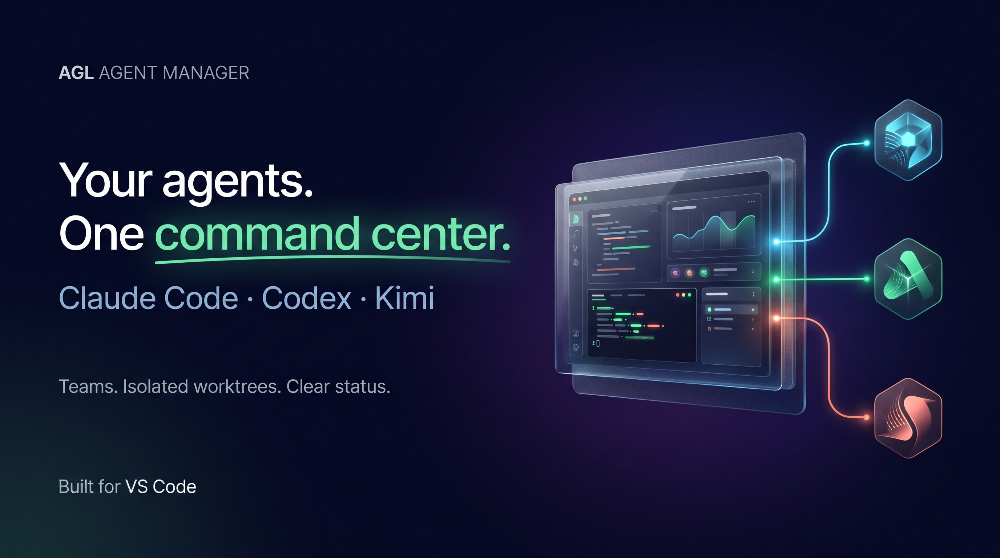
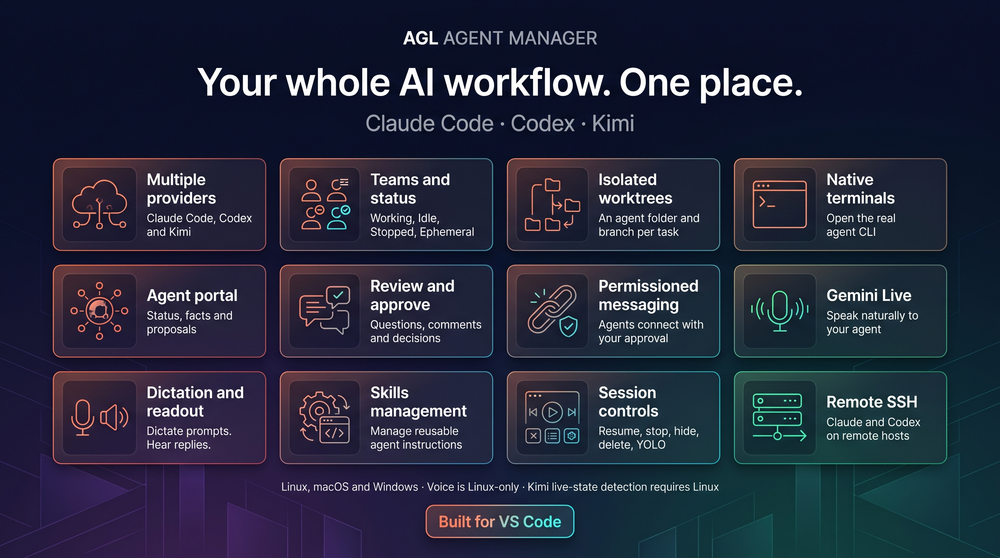
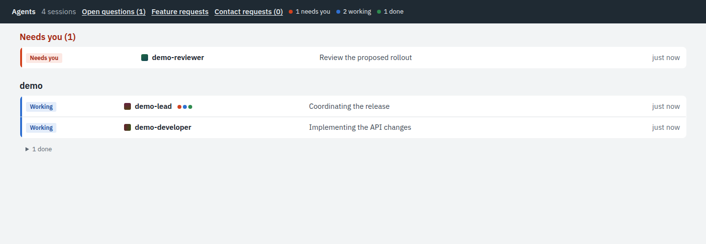
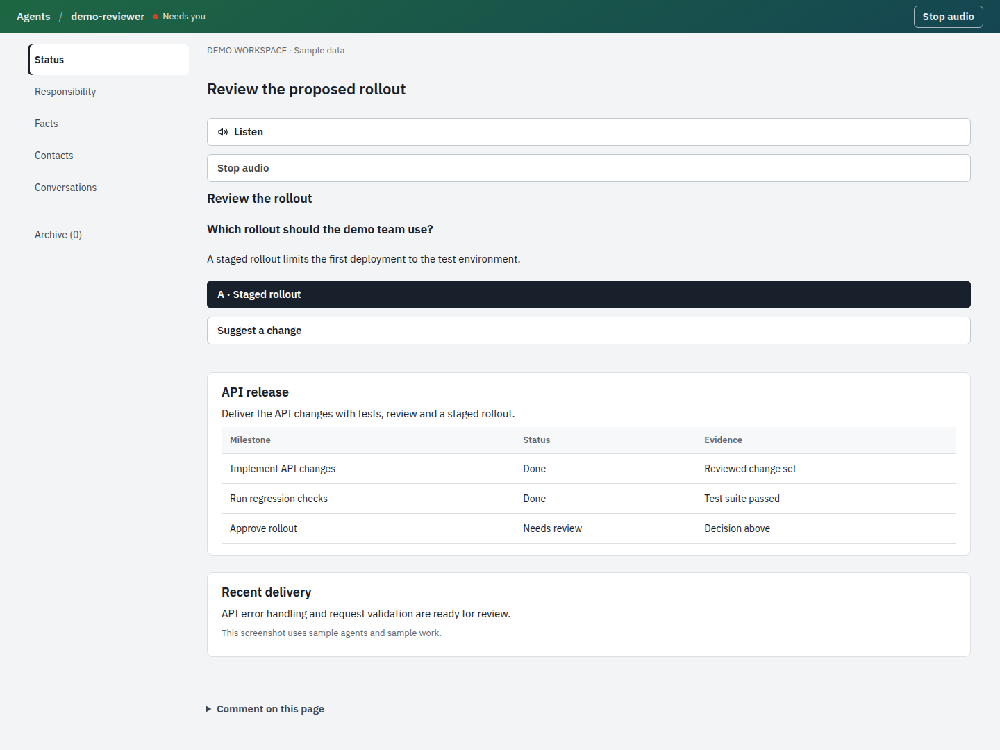
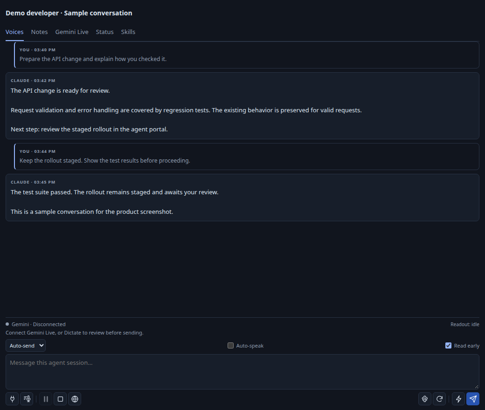

# AGL Agent Manager

**Run a team of AI coding agents from VS Code.** Claude Code, Codex, Kimi, GitHub Copilot CLI and Antigravity agents each get their own folder of git worktrees, appear together in one sidebar, and talk to each other and to you through a shared agent portal. You see at a glance who is working, who is idle and who needs you, and you can listen to replies or talk back by voice.

- **One list for every agent.** Claude, Codex, Kimi, Copilot and Antigravity agents, each with its own icon,, grouped into your **teams** and **Ephemeral** runs, each split into **Working**, **Idle** and **Stopped**. A dot (●) marks an agent that needs you: a permission prompt, a question, or a reply you have not read yet.
- **Isolated workspaces.** Each agent works in its own `.sessions/<agent>/<name>` folder with its own branch and worktrees, so agents never edit the same checkout.
- **Agent portal.** Every agent keeps a live status page, facts and proposals you can read and answer in the browser. Agents message each other only with your permission.
- **Native terminals.** Opening an agent attaches its real CLI in a VS Code terminal. Stop, delete, hide or restart an agent in YOLO mode from the right-click menu.
- **Voice.** Hear full replies read aloud with Gemini text-to-speech, and steer agents hands-free with Gemini Live.

## The full workflow

*The two pitch images are promotional artwork generated with Google Nano Banana Pro. The screenshots below show the actual interfaces with sample data.*

| Feature | What you get |
| --- | --- |
| Claude Code, Codex, Kimi, Copilot and Antigravity | Multiple agent providers in one sidebar |
| Named teams and Ephemeral runs | Working, Idle and Stopped groups; explicit list filters |
| Isolated worktrees | A managed folder, branch and repository worktrees for each task |
| Native terminals | Open and resume the agent’s real command-line session |
| Agent portal | Read status, responsibility, facts and proposals |
| Reviews and decisions | Ask questions, save comments and record approvals |
| Permissioned agent messaging | Choose which agents may contact each other |
| Gemini Live | Speak naturally to your agent on Linux |
| Dictation and reply readout | Dictate prompts and hear published replies on Linux |
| Skills management | Manage reusable instructions for your agents |
| Session controls | Resume, stop, hide, delete and restart in YOLO mode |
| Remote SSH | Work with Claude and Codex on remote hosts |

The core extension supports Linux, macOS and Windows. Voice is Linux-only. Kimi live-state detection requires Linux; Kimi SSH is not supported.

## Screenshots

These screenshots show the actual product interfaces with sample agents and sample conversations. They contain no private workspace data.

### Team overview in the agent portal

See who is working, who finished, and who needs your attention.

### Review status and decisions

Read each agent’s progress, inspect evidence, and approve or comment on proposed work.

### Replies and voice controls

Read full replies and compose the next prompt. Voice controls require your own API keys and currently support Linux.
The screenshot uses the extension’s voice renderer with a sample message bridge; Gemini is disconnected.

## What changed in 0.14.16

Stopped managed agents remain visible by default. Existing team members stay assigned when a newer transcript copy exists.
Agent providers populate the list independently, and a failed refresh keeps the previous list visible with a warning.
Explicit sidebar filters remain respected. Select **All** to include stopped agents.

## Quick start

1. Install at least one agent CLI: [Claude Code](https://code.claude.com), [Codex](https://developers.openai.com/codex), Kimi Code, GitHub Copilot CLI or Antigravity (`agy`).
2. Install this extension and open a project folder (a trusted workspace).
3. In the **AGL Agent Manager** view, press **+**, pick a provider and name the agent. It starts in its own session folder.
4. Optional, for voice: run **AGL Agent Manager: Configure Gemini Voice** and paste a [Gemini API key](https://aistudio.google.com/apikey). The key is kept in VS Code's secret storage.

Needs Python 3 (`python3`; on Windows the `py` launcher or `python`) and git. Gemini Live also needs a Python with the `websockets` package (see **Gemini Live** below).

## Platforms

| | Linux | macOS | Windows |
|---|---|---|---|
| Agent list, teams, terminals, workspace folders | yes | yes | yes |
| Agent portal, status pages, agent messaging | yes | yes | yes |
| Stop, delete, restart in YOLO | yes | yes | yes |
| Kimi running state | yes | sessions listed, not live state | sessions listed, not live state |
| Antigravity running state | yes | yes | sessions listed, not live state |
| Voice: read aloud, Gemini Live, Dictate | yes | not yet | not yet |

The automated tests run on all three systems for every change. Day-to-day use has been on Linux; please [report](https://github.com/agentlabs-common/agl-agent-manager/issues) anything that misbehaves on macOS or Windows. The prompt hooks call `node`, so Node.js should be on your PATH for unread-message notes in Claude and Kimi.

## Install

Install **AGL Agent Manager** (publisher Agentlabs) from the Visual Studio Marketplace, or download a VSIX from GitHub Releases as below.

**What it changes outside VS Code.** On activation it installs and keeps current, in your home folder:
- the `agl-notes` skill in `~/.claude/skills` and `~/.agents/skills` (a skill you wrote with the same name is never replaced);
- the agent portal tools in `~/.config/agentlabs/agl` (`agl-talk`, the status keeper, the prompt hook script);
- one UserPromptSubmit hook in `~/.claude/settings.json`, and in `~/.kimi-code/config.toml` when Kimi is installed, and a SessionStart/PreInvocation hook in `~/.gemini/config/hooks.json` when Antigravity is installed (a backup is written next to each file first).
Agents use these to keep status pages and to message each other. The extension itself sends data only for voice: to Google Gemini (speech and Live) and, for Dictate, to Deepgram, each with your own API key. The agent CLIs you run talk to their own providers.

Moving from a VSIX installed before 0.14.12 (ID `local-tools.claude-folder-agents`) or from a 0.14.13–0.14.14 test build (ID `Agentlabs.agl-agent-manager`): uninstall that copy. Settings and teams carry over; hidden sessions and each window's list filter start fresh.

Download the latest VSIX from [GitHub Releases](https://github.com/agentlabs-common/agl-agent-manager/releases/latest).
For Remote SSH, install the VSIX locally in VS Code. Voice playback runs on the local computer.

1. In VS Code, open **Extensions → … → Install from VSIX…**.
2. Select **claude-folder-agents-0.15.3.vsix**.
3. Run **Developer: Reload Window**.
4. Expand **AGL Agent Manager** in Explorer.

Terminal alternative:

`code --install-extension claude-folder-agents-0.15.3.vsix --force`

## Claude workspace trust

Run **AGL Agent Manager: Trust This Workspace for Claude** from the Command Palette or the **…** menu in either agent sidebar. If a launch reports missing trust, select **Trust Workspace and Retry** to approve the parent and continue automatically. The action approves the canonical parent workspace, even when invoked from an agent folder. It merges the trust flag into Claude’s configuration on the machine running the agents; SSH workspaces update the remote configuration. Other configuration entries are kept. No agent is started or interrupted.

Ordinary session subfolders inherit parent trust. Nested Git repositories and some project permissions can still require their own approval. This action does not enable YOLO mode.

## Codex sessions

Every provider appears together in **AGL Agent Manager**, limited to managed .sessions folders and their descendants.
**Providers** in extension settings can show either provider alone. A missing provider does not hide sessions from the other one.

Open a Codex row to launch `codex resume <thread-id>` with the shared Gemini voice pane. Repeated clicks reuse the terminal.
The extension reads Codex daemon history without sending prompts, forking threads, or changing approval policies. Native Codex handles terminal input and approvals.
Completed Codex replies use the same full-message TTS, Indian voice catalog, dictation, and Gemini Live prompt editing as Claude.

Use **+ → Codex**, **AGL Agent Manager: New Codex Session**, or **New Codex Session (YOLO)** to create a session.
Use **Restart Session in YOLO Mode** to interrupt the selected active turn and resume the same session with YOLO permissions. Ordinary opening attaches to a running session without interrupting it.
Codex YOLO uses `--dangerously-bypass-approvals-and-sandbox`.

The local or SSH host needs Codex with the shared daemon API (verified with 0.166.0).
New Codex sessions start the daemon when necessary. **AGL Agent Manager: Start Codex Daemon** starts it explicitly for discovery.
The microphone and Gemini key stay on the local VS Code computer. Codex history and native terminal traffic use SSH for remote folders.

[Official Codex app-server documentation](https://developers.openai.com/codex/app-server).

## Workspace sessions

**AGL Agent Folders** uses the AgentLabs logo for each agent folder and creates isolated folders of repository worktrees. Workspace isolation itself needs no skill; the `agl-notes` skill is for the agent portal.

1. Open the workspace containing the canonical repository clones.
2. Select **+** in **AGL Agent Manager** or **AGL Agent Folders**.
3. Choose Claude or Codex and enter an agent name, such as eb-dev. There is no repository picker or generated folder-name suffix.
4. The manager creates **.sessions/<agent>/<name>/** without worktrees or Git fetches.
5. It starts the selected native agent terminal and voice pane in the current VS Code window. The VS Code workspace stays open at the parent folder; only the agent process uses the new session folder as its working directory.
6. The agent chooses repositories from the task and uses the bundled **.agl/workspace.cjs** helper to add their worktrees on demand.

The default base is **main**, using **origin/main** when origin exists. Set **Workspace Base Branch** for another branch. When adding a worktree, its canonical clone must be clean and on that branch; canonical working trees are not switched, edited or built. The helper discovers repositories dynamically. Adding a worktree fetches the configured base branch and updates the session manifest. Failed additions roll back only newly created worktrees and preserve existing edits; retained paths are reported.

Each new session contains **.agl-session.json**, **AGENTS.md**, **CLAUDE.md**, and the portable **.agl/workspace.cjs** helper. The instructions tell the agent how to discover repositories and run **add <session-root> <repo-name> [repo-name...]** with the recorded Node runtime. The manifest starts with an empty repository list and records worktrees as the agent adds them. The manifest records native conversation IDs after launch for later resume. Existing .sessions/<agent>/<folder> directories are recognized even without a manifest. Worktree metadata is discovered from their canonical clones; no skill or manual migration is needed.

For example, VS Code remains open at **workspace-eb**, while Claude agent **eb-dev** runs in **workspace-eb/.sessions/claude/eb-dev/** and appears in that same window’s manager. Multiple agents remain visible there together. Existing older folders with ID suffixes remain supported and are not renamed.

**Working directory and history are separate.** A new agent starts in the specific session folder. Its conversation history stays in the native agent data directory on the machine running it, rather than being copied into the workspace folder. Existing agents are not moved, stopped, or deleted. The agent list excludes agents outside .sessions, including those started directly in the canonical workspace. Closed histories remain visible while their workspace folder still exists.

Select an agent-folder row to start or resume its agent in the same window. Repeating New Agent with an existing agent type and name opens that folder, including after a failed first launch. Repeated clicks share the same pending launch. **Reveal Agent Folder** expands the folder in the existing Explorer. Creating or reopening agents never calls Open Folder or opens another VS Code window. Native launchers currently support Claude and Codex.

**Remove Agent Folder…** checks all repositories before removing the first worktree. Running agents, dirty/untracked work, symbolic-link escapes, and unexpected files outside the repositories block removal. After confirmation, clean worktrees and ignored build outputs are removed; branches and native conversation history are kept. A later Git failure reports partial removal and preserves the remaining worktrees and metadata. Project skills or notes in the session must be moved or removed before cleanup.

The workspace and skill engines use Node APIs and Git argument arrays, without Bash. SSH jobs use Node on PATH or VS Code Server’s bundled Node; Windows SSH runtime discovery uses PowerShell and the Remote SSH platform setting. The existing microphone and playback requirements are separate below. Linux and real SSH integration were tested; Windows and macOS host runs have not yet been performed.

## Skills GUI

Select the **Manage Skills** book icon in the main manager toolbar, or run **AGL Agent Manager: Manage Skills**.
**AGL Skills** manages folder-based skills separately from workspace isolation. It groups workspace and personal sources for Claude, Codex/shared AGENTS skills, legacy Codex locations, and Kimi Code locations on the selected local or SSH host.

- **New Skill** creates a SKILL.md from a name and description and opens it for editing.
- **Import Skill Folder** copies a folder containing SKILL.md and its supporting files into the chosen source; existing skills are not overwritten.
- Select a skill to edit its SKILL.md. Bundled system skills open as a preview without editing their source.
- **Disable Skill** moves the entry outside the provider’s discovery directory; **Enable Skill** restores it without overwriting a replacement.
- **Remove Skill…** requires confirmation. Removing a linked entry keeps the linked source folder.

Save or discard unsaved skill edits before disabling or removing a skill. Changes affect future skill discovery; a running agent may need to reload or restart. Project skills are scoped to the selected workspace folder; personal skills apply on that host. Skills supplied by plugin catalogs and GitHub installation are not managed by this first GUI version.

### Skills for one agent

The **Skills** tab supports Claude, Codex and Kimi Code. Switches apply to all conversations in the selected agent folder. They do not change another agent folder or move personal skill sources.

| Provider | How the switch is applied | When it takes effect |
| --- | --- | --- |
| Claude | Native `skillOverrides` and `enabledPlugins` in `.claude/settings.local.json`; other settings are kept | Claude reloads local settings. Restart if a change does not appear. Plugins may require reload/restart. |
| Codex | Folder-local `.agl/codex-skills.json`, passed as native `skills.config` session overrides | Close and reopen the agent from AGL. Global Codex settings are kept. |
| Kimi Code | Folder-local `.agl/kimi-skills.json` and a generated catalog passed with `--skills-dir` | Close and reopen the agent from AGL. Source folders and their resources are kept. |

Codex's native catalog supplies its skill list, including system and plugin skills. Kimi switches cover project and personal directory skills; extra-directory skills and name collisions with extra-directory skills are read-only because Kimi loads those separately. Kimi's built-in and plugin skills remain managed by Kimi. Claude plugins switch as a whole.

Closing and reopening means resuming the same conversation through AGL, without deleting it or switching permission modes. Skills already read can remain in conversation history; start a new conversation if those earlier instructions must leave the context. Starting a CLI manually outside AGL does not apply the Codex/Kimi folder switches.

Native verification uses `scripts/audit-native-claude-skills.py`, `scripts/audit-native-codex-skills.py` and `scripts/audit-native-kimi-skills.py` on Linux with Python 3 and the corresponding CLI installed. Set `AGL_NODE` to the Node executable when needed. Each checks enabled, disabled and re-enabled discovery in disposable folders. Kimi's probe uses a local synthetic model endpoint and no production credential. No probe sends work to an existing agent.

Source discovery follows [Codex skills](https://developers.openai.com/codex/skills) and [Claude skills](https://code.claude.com/docs/en/skills). Session instructions follow [Codex AGENTS.md](https://developers.openai.com/codex/guides/agents-md) and [Claude memory](https://code.claude.com/docs/en/memory).

## Agent portal (status pages)

Each session keeps its pages in `.agl/`: `STATUS.openui` (its status page), `FACTS.md`, `pages/*` (proposals, designs, guides, its Responsibility page) and `reviews.json` (your answers). Pages are written in [OpenUI Lang](https://github.com/thesysdev/openui) and drawn by the portal's own components; HTML and Markdown pages still work. The bundled **agl-notes** skill teaches agents the format and the status rules.

- The **Agent Portal** row at the top of AGL Agent Manager (or the globe icon) opens the agent portal in your browser, on 127.0.0.1 only, with a random token in every URL. The home page lists every session in the workspace, needs-you first, with stale, review and **needs migration** marks.
- Each session page has a sidebar: Status, Responsibility, Questions and Facts, then one foldable entry per work item with its pages, and an Archive for finished work.
- **Answering:** a question's buttons only ask. The portal shows its own box with the exact text, and only your click records it in `.agl/reviews.json`. Answered questions are marked at once; agents that wait in the background pick the answer up straight away.
- **Listen** reads a question aloud, generated live with Gemini (`tts.py`); **Stop audio** beside it, or in the top bar, stops any speech, including the voice hooks' queue (`~/.claude/hooks/hush.sh` when present). Answering also stops it.
- Agent pages run sealed off in a sandbox: they can use JavaScript, but have no network, no forms and cannot approve anything themselves.

- **The session list** groups sessions by team (a seat names its lead, or the portal infers it from the name), needs-you first, with **Open questions** across all sessions and **Feature requests** (why agents went beyond the standard components).
- **Status keeper:** plain checks of each agent's pages against the status guide. You see them on the list and on the agent's page; the agent hears them at its next prompt.
- **Lead pages** carry only what the lead pulls in (`Pull`), live and read-only. **Approvals** keep a fingerprint: a page changed after you approved it shows a warning.
- Containers labelled `agl.session=<agent>/<name>` show live on the status page. Agents may add their own HTML and JavaScript in a sandboxed `Custom` block, with Chart.js as a shared library.

- **Agent communication:** agents talk only through the portal, with `agl-talk`. Each agent has a **Contacts** page where you allow, deny or withdraw each contact, and a **Conversations** page; **Contact requests** on the home page gathers what's waiting for you. A message from an allowed contact wakes a stopped agent unless you've put it on hold; each wake is logged. Each agent has its own gradient.

- **Local names:** everything on this machine has a canonical name such as `auth.dev-1.desk.localhost`. Containers carry it in the `agl.host` label, and the status page shows it with its port.

**Delivery on every update.** On start (so after every update) the extension installs its skills as whole folders stamped with its version into `~/.claude/skills` and `~/.agents/skills` (never replacing a skill it did not install), copies the agent tools to `~/.config/agentlabs/agl/`, writes `~/.config/agentlabs/agl/agent-portal.json` (version, portal address, formats, migrations), and adds one `UserPromptSubmit` hook to `~/.claude/settings.json` (a backup is kept as `settings.json.agl-backup`). The hook tells an agent at its next prompt when its skill is newer than the one it last acknowledged, and lists the files to migrate with `agl-migrate.cjs`.

The **Status** tab in the Voice pane shows the same status for that agent. Local workspaces only for now; SSH sessions are not shown. Notes in `.agl/` block **Remove Agent Folder…** until you move or delete them.

## Teams and groups

The list splits into your **teams** and **Ephemeral**. Each has three groups: **Working** (in a turn, waiting on a permission prompt, or with a question for you), **Idle** (running between turns; open one to go straight to its terminal) and **Stopped** (no running process; open one to start it again). Rows are sorted by name inside each group, so a refresh never reshuffles the list.

Every conversation starts as Ephemeral: copies, one-off runs and new agents alike. Right-click one and choose **Add to Team…** to put it in a team you pick or a new one. Right-click a team to **Rename Team** or **Delete Team** (its agents go back to Ephemeral). A conversation is in one team at a time. Teams are saved per workspace in `.sessions/teams.json`, so every window and agent sees the same teams.

Right-click a running agent for **Stop Agent**. It asks first, ends the current turn and process, and keeps the conversation to resume later.

## Closed and hidden sessions

The default **All sessions** filter includes running sessions, saved Claude conversations, and closed or archived Codex conversations under existing .sessions workspace folders. The extension cannot recover history already removed by the agent.
Use the **Filter Sessions** funnel in the view title to choose **All**, **Running**, **Closed**, or **Hidden** sessions.

Right-click a session for **Hide Session**. This changes only this extension's view and keeps the conversation and any running task.
Choose **Hidden sessions**, then right-click **Restore Hidden Session** to show it again.

**Delete Session…** permanently removes the selected conversation after confirmation. A running agent is stopped first.
For Codex, native deletion also removes spawned child sessions. For Claude background agents, native deletion may remove its managed worktree; the confirmation explains this before deletion. Saved interactive Claude conversations delete their transcripts while keeping project files.
Opening an archived Codex conversation restores that same thread before opening its terminal.

## Folder scope

The default scope is the active editor's workspace folder, or the first open folder.
Right-click a canonical workspace or session folder and select **Show AGL Agent Manager**.
**AGL Agent Manager: Show Sessions in Workspace Folders** restores the default scope.
Canonical workspace paths resolve symbolic links. Managed session paths themselves must not be symbolic links.
The list includes only agents whose working directories are inside a recognized .sessions folder; it includes descendant repository directories and excludes canonical clones.

## Terminals

The extension reads native agent inventories and saved conversations, then applies .sessions directory boundaries before displaying or attaching them.
It attaches native background sessions with `claude attach <id>`.
The **+** button lets you choose Claude or Codex. Claude starts a native background session; Codex creates a thread and opens its native terminal.
Repeated clicks reuse the session's terminal and voice pane.
Closing the terminal does not stop a background agent.

A live interactive session in tmux opens through a separate grouped tmux client.
The extension checks the process ancestry before it attaches.
A live session in another ordinary terminal cannot be attached.
The extension reports this limitation and prevents a duplicate resume.

## YOLO mode

Run **AGL Agent Manager: New Agent Session (YOLO)** to create a named agent folder and start it in the current window.
This starts Claude with `--dangerously-skip-permissions`, which skips all permission checks.
Enable **AGL Agent Manager: Yolo Mode** to use it by default for new sessions and resumed inactive interactive sessions.
It works locally and over SSH. To change an existing session, right-click it and select **Restart Session in YOLO Mode**.
This interrupts its current task, stops the existing process, and resumes the same conversation with permission checks skipped.
The extension verifies the folder and waits for the previous process to stop before resuming. Ordinary clicks still attach without changing its mode.

## Voice

Replies populate both Voices and Gemini Live even when auto-speak is off or an audio helper fails.
The pane shows the full published reply. Speech skips paths, URLs, filenames, and fenced code.
Click a reply in either tab to hear it with the selected Gemini TTS voice.
**Auto-speak** queues new replies without interrupting audio already playing.
**Pause**, **Resume**, and **Stop speech** control playback.

Connection status, microphone controls, settings, playback controls, and the composer are grouped at the bottom.
Action buttons use compact icons. Hover for a tooltip; each button also has an accessible label.

**Dictate** (optional) is plain speech-to-text with Deepgram. It needs the separate agentlabs-voice speech tools (`~/.claude/hooks/stt-stream.py`, its Python environment in `~/.venvs/tts`, and a Deepgram key in `~/.claude/hooks/tts.conf`); without them the button explains what is missing. Press it to start; press it again to stop.
Gemini turns your spoken thought into a lightly polished draft. Edit it and select **Send** when ready.
In **Auto-send polished prompt** mode, complete spoken prompts go directly to the selected agent terminal.
Typed prompts are sent as written. **Interrupt** sends Ctrl+C to the terminal.
Closing the voice pane stops its microphone and connection.

## Gemini configuration

Click **⚙** in the voice pane or AGL Agent Manager toolbar, or run **AGL Agent Manager: Configure Gemini Voice**.
Choose the TTS model, one of 30 voices or a custom voice ID, speaking style, Live model, pause timing, prompt polishing, microphone behavior, or Python executable.
For Indian female voices, choose **TTS voice → Indian English · Female** or **Hindi · Female**.
**Browse voice catalog…** offers Indian languages and gender filters. The catalog uses the voices available to your Gemini API key.
Each result shows its name, language, accent, gender, pitch, and description. Search matches these details.
Select a voice, then **Preview voice** to hear it or **Use this voice** to save it. **Stop preview** stops the sample.
Preview does not change your saved voice. Catalog previews use your Gemini TTS quota.

TTS changes apply on the next readout. Reconnect Live after changing its key, Live model, pause timing, prompt polishing, or Python executable.

**Set Gemini API key** saves the key in VS Code secure storage on the local computer. It takes priority over environment and keys.env values for both TTS and Live.
The key is passed only to local voice helpers, not to the webview, command arguments, repository settings, or SSH host.
**Remove saved API key** restores the environment or keys.env fallback.

## Gemini Live

All microphone input uses the conversational **gemini-3.8-live** model. No Deepgram or external speech hooks are used.

1. Select **Connect Gemini Live** in the bottom controls.
2. Speak naturally. Gemini keeps context across thinking pauses and self-corrections.
3. Gemini decides when your thought is complete and sends it. If it never does, what it heard is sent after the pause. When unsure, it asks “Send that?”.
4. Use **Send now** to explicitly end a dictation, or **Disconnect** to stop the microphone.
5. Gemini reads the agent’s replies aloud in its own voice. Ask it about a reply (“did the tests pass?”) and it answers from the reply without sending anything to the agent.
6. Say **stop** or **quiet** to stop reading, **read that again**, **stop the agent** to interrupt it, or **cancel** / **scratch that** to drop the current dictation.

Prompts are typed into the agent terminal and Enter is pressed separately, so long dictation is submitted instead of being treated as a paste.

The default minimum silence window is **3 seconds**. In settings, choose **Pause before sending** to use 3, 5, or a custom 1–10 seconds.
Gemini can continue waiting if the thought is incomplete. Fillers such as “right” and “or rather” are not submitted on their own.
After **3 minutes without microphone activity**, Live disconnects automatically. Unfinished dictation is preserved in the composer, and reply readout stays available.
**Remove spoken redundancy** removes only repeated wording and hesitation sounds. It keeps all distinct requirements, self-corrections, numbers, paths, and technical details. Unsafe edits fall back to the complete original dictation. Failed submissions stay visible as a draft.
Disable it to preserve the original wording. Reconnect after changing Live settings.

Gemini is a voice companion, not the coding agent. Claude or Codex performs the task.
While Live is connected, Gemini Live speaks replies (set `GEMINI_LIVE_VOICE` for a prebuilt Live voice). When it is disconnected, readout uses the dedicated Gemini TTS API with the selected catalog voice.
Live sessions resume automatically when Gemini rotates the connection. Events, without partial transcripts, are logged to `~/.cache/agl-agent-manager/live.log`.

The connection icon stays green while connected; click it to disconnect. Live transcription appears above the composer on every tab.
All action icons share one bottom toolbar. Pause and Resume share a position. Hover an icon for its label.
**Mute mic** mutes input. **Review** places spoken prompts in the composer instead of submitting them.
The microphone pauses during reply playback by default to prevent speaker echo.
With a headset, **Live Barge In** keeps it active during playback.

The Gemini key comes from VS Code secure storage, the environment, or ~/.config/agentlabs/keys.env.
The Live Python environment needs **websockets**, and the local computer needs **arecord** and **aplay**.
Speech starts after the agent publishes reply text, so the agent’s own response time still affects readout latency.

[Gemini Live documentation](https://aistudio.google.com/docs/live-api).
[Gemini TTS documentation](https://aistudio.google.com/docs/speech-generation).

## Remote sessions

Run **AGL Agent Manager: Open Remote Working Directory over SSH**.
Enter your SSH host and an absolute working directory on that host.
The list then shows agents only under that workspace’s .sessions folders.
**Show Sessions in Workspace Folders** returns to the local workspace.

The extension sends its Python helper over SSH stdin without installing it remotely.
The remote machine needs Python 3, native Claude Code, and working SSH authentication.
Terminal attachment also uses SSH, launched explicitly on the local computer to avoid a second SSH connection from the remote workspace.
The extension decodes VS Code SSH connection details and uses the configured **Remote.SSH: Path** and **Remote.SSH: Config File**, including custom user and port settings.
The microphone and speech playback run on this computer.
Remote transcript summaries travel over SSH to the voice pane.
No global remote-machine or agent list is shown.

This extension runs locally in VS Code, including when the workspace uses Remote-SSH.
A phone or browser client does not stream its microphone to the extension.

## Requirements

- Native Claude Code with `claude agents --json`, `claude --bg`, and `claude attach` (checked with 2.1.318).
- VS Code 1.85 or later on Linux, macOS or Windows (see **Platforms**), Python 3, git, and a trusted workspace.
- For voice (Linux for now): arecord, aplay, a Gemini API key, and a Python environment with websockets.
- For live interactive tmux sessions: tmux.

**AGL Agent Manager: Claude Path** sets the local CLI executable.
**Show Saved** includes completed native background sessions.

## Development

Run `npm install` first to install the WebSocket transport dependency.

Open this directory in VS Code and press **F5**.
`npm test` checks managed-session boundaries, worktree lifecycle, skill management, native terminals, SSH transport, and voice lifecycle.
`npm run test:host` loads the extension in an isolated VS Code window (requires Xvfb).
`npm run package` builds the VSIX.
The packaged extension includes the ws WebSocket transport dependency.

## Antigravity sessions

Antigravity agents run the Antigravity CLI (`agy`, set its path with **AGL Agent Manager: Antigravity Path**). Create one with **+ → Antigravity** or **New Antigravity Session** (YOLO adds `--dangerously-skip-permissions`). Opening a row resumes the same conversation with `agy --conversation <id>`; the voice pane reads replies from Antigravity's own transcript.

The list comes from Antigravity's ACP server. A session shows as running while its `agy` holds its presence lock (Linux and macOS). Antigravity has no way to delete a conversation yet, so **Delete Session** says so and leaves it; use **Hide Session** instead. Skills: Antigravity reads the shared `.agents/skills` folder and `~/.gemini/config/skills`, where the extension also installs `agl-notes`. Unread agent messages and skill updates reach it through a SessionStart and PreInvocation hook, injected once per change.

## GitHub Copilot CLI preview

Use **New Copilot Session** or choose **Copilot** in the agent-folder wizard. Sign in first with `copilot login`; the adapter uses your existing subscription. `AGL Agent Manager: Copilot Path` selects the installed CLI. Current support is local, with SDK protocol 3 verified against CLI 1.0.108.

Create/resume, native terminals, chat/readout history, teams, portal pages and native user skill switches are supported. Copilot skill switches currently affect the account, not just one agent folder. Agents opened in AGL can be stopped and resumed without deleting their conversation. Gemini voice retains its Linux requirements.

Allowed messages can wake a stopped Copilot agent in the same conversation. Running agents use their listener; Hold, contact permissions, cooldown, failure backoff and duplicate-start locks apply. No YOLO/allow-all flags are added to a wake. Ambiguous activity leaves messages queued.

See [the feature assessment](docs-copilot-assessment.md) for remaining gaps, including SSH, agent-folder-only skills and detailed live activity/permission badges. This is an integration candidate, not a claim of full provider parity.
